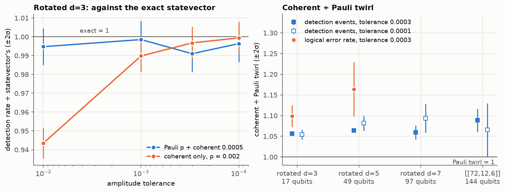

# Extended stabilizer: coherent errors past a statevector

On hardware, most gate error is stochastic, and a smaller part is coherent:
over-rotations whose amplitudes add up between syndrome measurements. A
statevector holds 2^n amplitudes, so it stops at about 30 qubits, and a matrix
product state needs a bond dimension that grows with the width of the code.
Maestro's extended stabilizer holds the state as a Clifford acting on a sparse
list of components instead. Clifford gates and Pauli noise add none. A coherent
over-rotation can add some, and every round of syndrome measurements removes
them. With `extended_stabilizer_amplitude_tolerance` it drops components whose
amplitude is at most that fraction of the state's norm, so the list holds only
the error branches that matter. Here that runs coherent errors on surface codes
up to d=7 (97 qubits) and on the [[72,12,6]] bivariate bicycle code (144
qubits), which neither a statevector nor an MPS can hold.

```python
import maestro
from deltakit_maestro import MaestroBackend

backend = MaestroBackend(
    simulation_type=maestro.SimulationType.ExtendedStabilizer,
    extended_stabilizer_amplitude_tolerance=3e-4,
)
sampler = backend.compile_sampler(noisy, decoder=None, noise_type='full', coherent=5e-4)
dets, obs = sampler.sample_detection_events(shots)
```

The tolerance is new in Maestro 0.3.16.

Every circuit here is a Deltakit Z-basis memory experiment under SI1000(p=0.002),
whose Pauli noise Maestro samples. `noise_type='full'` adds a coherent
over-rotation of infidelity 5×10⁻⁴ after every gate, a quarter of the
two-qubit gate's Pauli error. It rotates about a body diagonal of the Bloch
sphere, with a sign drawn once per qubit per shot (see [Coherent
noise](../guide/coherent_noise.md)). Its Pauli twirl replaces the over-rotation
by `DEPOLARIZE1(5e-4)`. Every run is decoded with the twirl's detector error
model, as on [Coherent noise against its Pauli twirl](coherent.md).

In short: on the rotated d=3 code, where Maestro's exact statevector runs
too, the extended stabilizer agrees with it at every tolerance tried in this
case, and from a tolerance of 3×10⁻⁴ in the hardest case, coherent noise
only. Past the statevector, a coherent part a quarter the size of the Pauli
noise gives 5–9% more detection events than its twirl on surface codes up to
d=7, and 9% more on the [[72,12,6]] bivariate bicycle code. The logical error
rate rises more, by 10% at d=3 and by at least 16% at d=5, so the twirl
overstates how fast it falls with distance. A shot takes from 15 ms at d=3 to
15 s at d=7 and 4 minutes on [[72,12,6]], and the larger codes need a tighter
tolerance than d=3.

## Against the exact statevector

The rotated d=3 surface code has 17 qubits, so Maestro's exact statevector
runs it too. 100,000 shots of each, with independent seeds, each z-score against
the one statevector run:

Pauli noise plus coherent 5×10⁻⁴:

| Run | Detection rate | z | LEP | z | ms a shot |
|:---|---:|---:|---:|---:|---:|
| statevector (exact) | 0.05958 |  | 0.0180 |  | 27 |
| tolerance 10⁻² | 0.05926 | −1.1 | 0.0172 | −1.3 | 2 |
| tolerance 10⁻³ | 0.05949 | −0.3 | 0.0177 | −0.5 | 3 |
| tolerance 3×10⁻⁴ | 0.05904 | −1.8 | 0.0170 | −1.8 | 13 |
| tolerance 10⁻⁴ | 0.05936 | −0.7 | 0.0173 | −1.2 | 34 |

Coherent over-rotations only, of strength p=0.002:

| Run | Detection rate | z | LEP | z | ms a shot |
|:---|---:|---:|---:|---:|---:|
| statevector (exact) | 0.07289 |  | 0.0237 |  | 27 |
| tolerance 10⁻² | 0.06877 | **−13.5** | 0.0179 | **−9.1** | 2 |
| tolerance 10⁻³ | 0.07214 | −2.4 | 0.0228 | −1.4 | 15 |
| tolerance 3×10⁻⁴ | 0.07265 | −0.8 | 0.0235 | −0.3 | 39 |
| tolerance 10⁻⁴ | 0.07284 | −0.1 | 0.0237 | −0.0 | 73 |



Pruning drops error branches, and in every run here a tighter tolerance gave
as many errors or more: a loose one moves a result toward the Pauli twirl. With
the coherent part at a quarter of the Pauli noise, every tolerance from 10⁻²
down agrees with the statevector. The z-scores lean negative because they share one statevector run;
the 400,000-shot run at 3×10⁻⁴ below gives a detection rate of 0.0594 ± 0.0001
and an LEP of 0.0179 ± 0.0002, within 1σ of the statevector's.

The second table is the hardest case: coherent over-rotations of the full
strength p in place of the gates' Pauli noise (`noise_type='coherent'`), as on
[Coherent noise against its Pauli twirl](coherent.md). There a branch with two
coherent errors in one round still matters. At 10⁻² the extended stabilizer
undercounts logical errors by a quarter, and at 10⁻³ detection events by 1%
(z = −2.4). From 3×10⁻⁴ it agrees. In this case the statevector is faster on
d=3 (27 ms a shot against 39 ms at 3×10⁻⁴); the extended stabilizer is for
what comes after it.

## Past the statevector: coherent against its twirl

Each code at tolerance 3×10⁻⁴ against its twirl on Stim, and checked at 10⁻⁴
with fewer shots:

| Code | Qubits | Twirl | Coherent, 3×10⁻⁴ | Ratio | Coherent, 10⁻⁴ | Ratio | z | LEP ratio |
|:---|---:|---:|---:|---:|---:|---:|---:|---:|
| rotated d=3 | 17 | 0.0562 | 0.0594 | 1.056 ± 0.002 | 0.0593 | 1.054 ± 0.006 | +0.3 | 1.10 ± 0.01 |
| rotated d=5 | 49 | 0.0646 | 0.0687 | 1.064 ± 0.002 | 0.0699 | 1.082 ± 0.009 | −1.9 | 1.16 ± 0.03 |
| rotated d=7 | 97 | 0.0685 | 0.0726 | 1.059 ± 0.009 | 0.0749 | 1.094 ± 0.017 | −1.8 | — |
| [[72,12,6]] | 144 | 0.1204 | 0.1311 | 1.089 ± 0.014 | 0.1283 | 1.065 ± 0.032 | +0.7 | — |

The coherent shots are 400,000 at d=3 (40,000 at 10⁻⁴), 100,000 at d=5
(3,200), 1,280 at d=7 (320) and 320 on [[72,12,6]] (64); the twirl's, 20
million on each surface code and 200,000 on [[72,12,6]]. A z-score compares the
two tolerances. The surface codes run d rounds and [[72,12,6]] 6, decoded by
PyMatching and by BP-OSD (`ldpc`, OSD-0) with the twirl's detector error model.

A coherent part a quarter the size of the gates' Pauli noise gives 5–9% more
detection events than its twirl on every surface code, and 9% ± 1% more on the
bivariate bicycle code. Each of its data qubits takes part in six CNOTs a round,
against four on the surface code, so more over-rotations add up between
syndrome measurements. Neither a statevector nor an MPS holds that code: its
checks join qubits far apart (see [When to use Maestro](../guide/when_to_use.md)).

At d=5 and d=7 the run at 3×10⁻⁴ lies 1.9σ and 1.8σ below the one at 10⁻⁴, in
the direction pruning moves a result, where on d=3 the two agree. A larger code
holds more coherent errors between syndrome measurements, so it needs a tighter
tolerance: read its excess at 3×10⁻⁴ as a lower bound. At 10⁻⁴ it is 8% at d=5
and 9% at d=7. On [[72,12,6]] the check, 64 shots at 31 minutes each, agrees
(z = +0.7) but is loose: ±3%.

The logical error rate rises more than the detection events: by 10% at d=3 and
by at least 16% at d=5 (1,246 coherent logical errors). So the twirl overstates
how fast logical errors fall with distance, as it does on repetition codes (see
[Coherent noise against its Pauli twirl](coherent.md)): from d=3 to d=5 the
twirl's logical error rate falls by a factor of 1.52, the coherent one by at
most 1.43 ± 0.04. At d=7, 1,280 shots hold only 16 logical errors, too few for a
ratio, and the same goes for [[72,12,6]].

## What it costs

The time one worker takes for a shot, with 32 workers on 16 cores:

| Code | Qubits | Tolerance 3×10⁻⁴ | 10⁻⁴ |
|:---|---:|---:|---:|
| rotated d=3 | 17 | 15 ms | 38 ms |
| rotated d=5 | 49 | 1.1 s | 4.9 s |
| rotated d=7 | 97 | 15 s | 2.1 min |
| [[72,12,6]] | 144 | 4.2 min | 31 min |

The statevector takes 27 ms a shot on d=3, and holds nothing larger.

The cost follows how many coherent errors a round holds, about the coherent
infidelity times the number of gates in a round, more than the number of
qubits. A tighter tolerance keeps branches with more errors, so here each step
of 3× costs 3–8× more, and the bivariate bicycle code, with more gates a round,
costs most. So:

- The extended stabilizer suits a coherent part smaller than the stochastic one.
  With coherent noise as strong as the Pauli noise it would have, the
  statevector is faster on d=3 (above), and the extended stabilizer's cost
  climbs fast past it.
- Logical error rates need many shots. The 1,280 shots at d=7 took 5 core-hours
  and hold 16 logical errors; a ratio good to 10% needs about six times as many.
- Without a tolerance the extended stabilizer is exact, and on these circuits it
  holds as many components as a statevector holds amplitudes: in a separate run
  on d=3 with coherent noise only, it was 25 times slower than the statevector.

## How it was run

On a Google Cloud `c4-standard-32` (Intel Xeon Platinum 8581C, Emerald
Rapids, 16 cores with 32 threads, Ubuntu 24.04) in November 2026, with 32 worker
processes of one thread each and nothing else running: a time a shot is one
worker's, with every other thread busy. Software: Maestro 0.3.16, Deltakit
0.10.2, Stim 1.16.0, PyMatching 2.4.0, ldpc 2.4.1, Python 3.12.

```bash
OMP_NUM_THREADS=1 WORKERS=32 python benchmarks/extended.py   # ~4½ hours on 32 threads
```
